<div align="center">

                                                                                 

### ⚡ Next-Generation In-Browser Web Spider & Endpoint Discovery Engine ⚡

*A browser extension port inspired by [ProjectDiscovery Katana](https://github.com/projectdiscovery/katana), supercharged with interactive single-tab DOM exploration, CAPTCHA bypass capability, automated button discovery, and deep JavaScript regex spidering.*

<br/>

[](manifest.json)
[](#-installation)
[](#-features)
[](#-deep-katana-regex-engine)
[](LICENSE)

<br/>

[🚀 Quick Start](#-installation) • [✨ Key Features](#-features) • [🧠 Architecture](#-architecture--workflow) • [📊 Comparison](#-katana-cli-vs-katana-ext) • [💻 Usage Guide](#-usage-guide) • [📤 Export Formats](#-exporting--pipeline-integration)

</div>

---

## 🌟 Overview

**Crawlizer** brings the reconnaissance power of headless web spidering directly into your browser workflow. Instead of dealing with CLI sandboxes, headless Chromium crashes, or IP bans, Crawlizer runs natively inside your Chromium session (Chrome, Brave, Edge).

Simply upload or drag & drop your `.txt` target list (such as `alive.txt` from `httpx` or `subfinder`), and Crawlizer automatically explores web routes, executes client-side Single Page Applications (React, Next.js, Vue, Angular), clicks interactive elements, extracts hidden endpoints and secrets from JavaScript source files, and exports deduplicated routes ready for **Nuclei**, **FFUF**, and **Burp Suite**.

---

## ✨ Features

<div align="center">

| Feature | Description |
| :--- | :--- |
| 🎯 **Single-Tab Interactive Navigation** | Uses **one dedicated browser tab** to navigate targets one-by-one, executing all dynamic JS without eating RAM. |
| 🛡️ **Zero-Friction CAPTCHA Solving** | Detects Cloudflare Turnstile, reCAPTCHA, and hCaptcha. Pauses, rings an alert, lets you solve it, and resumes! |
| 🖱️ **Automated Button & Tab Exploration** | Automatically clicks interactive `<button>`, `role="tab"`, and dropdowns while intercepting `fetch`/`XHR`. |
| 🚫 **Smart Asset Guard** | **Never loads `.js` or `.css` into the tab** (avoids raw code rendering); fetches JS in background for regex extraction. |
| 🌐 **Apex & Subdomain Spider Mode** | Discovers and recurses into subdomains (`*.target.com`) when enabled, or strictly confines to exact hostname. |
| 🧹 **Strict Canonical Deduplication** | 3-tier deduplication (Visited, Enqueued, and IndexedDB) with query param sorting and slash normalization. |
| ⚡ **Deep Katana & LinkFinder Regex** | Parses script files for REST APIs, GraphQL endpoints, routes, actions, and hidden parameters. |
| 💾 **IndexedDB High-Capacity Storage** | Seamlessly stores 100,000+ endpoints with instant multi-filter search and sub-millisecond query latency. |
| 🎨 **Sleek Cyber Glassmorphism UI** | Modern dark-mode interface with ambient glows, live RPS telemetry, pill tabs, and real-time logs. |

</div>

---

## 📊 Katana CLI vs. Katana-Ext

| Capability | ProjectDiscovery Katana (CLI) | Katana-Ext (Browser Extension) |
| :--- | :---: | :---: |
| **Execution Environment** | Go Binary / Headless Chrome | Native Chromium Extension (Chrome / Brave / Edge) |
| **Target Input** | Terminal flags / stdin (`-list`) | **Drag & Drop `.txt` file** (`alive.txt`) or Direct Input |
| **SPA & Client-Side JS** | Requires external Chrome binary | **Native browser execution** (zero extra binaries) |
| **Cloudflare / CAPTCHA Handling** | ❌ Blocked / Fails on challenges | ✅ **Detects challenge, pauses, lets you solve in tab, resumes** |
| **Interactive DOM Clicking** | Limited action triggers | ✅ **Monkey-patches `fetch`/`XHR` + automated button clicks** |
| **Asset Navigation Guard** | Navigates raw assets if queued | ✅ **Enqueues app routes, parses JS in background only** |
| **Subdomain Crawl Mode** | CLI scope flags | ✅ **Interactive toggle for `*.domain.com` spidering** |
| **Authentication & Sessions** | Cookie headers / flags | ✅ **Uses existing browser session cookies & tokens** |
| **Results Storage & Search** | File outputs (`output.txt`) | ✅ **Persistent IndexedDB database with instant live search** |
| **One-Click Export** | Custom scripting needed | ✅ **TXT (line-delimited), JSON, CSV, Clipboard** |

---

## 🧠 Architecture & Workflow

```mermaid
flowchart TD
    subgraph INPUT ["Target Ingestion"]
        A["📁 Upload alive.txt / Seeds"] --> B["Targets Queue & Scope Filter"]
    end

    subgraph ENGINE ["Single-Tab Crawler Engine"]
        B --> C{"Check Visited / Canon Dedupe"}
        C -- "Already Visited" --> SKIP["Discard Duplicate"]
        C -- "New Route" --> D{"Is Navigable Route?"}
        
        D -- "Yes (HTML / Endpoint)" --> TAB["Navigate Single Dedicated Browser Tab"]
        D -- "No (.js Script File)" --> BG["Fetch in Background via Fetch API"]
        
        TAB --> EXTRACT["In-Tab Extraction Script"]
        EXTRACT --> CHK{"CAPTCHA / Cloudflare Detected?"}
        CHK -- "Yes" --> PAUSE["Pause Crawl & Bring Tab to Focus -> User Solves"]
        PAUSE --> RESUME["User Solves -> Resume Extraction"]
        RESUME --> DOM["Scrape DOM Links, Forms, Meta, Comments"]
        CHK -- "No" --> DOM
        
        DOM --> CLICK["Interactive Clicker: Buttons, Tabs, Menus"]
        CLICK --> INTERCEPT["Intercept window.fetch, XHR & pushState"]
        INTERCEPT --> DISCOVERY["Discovered API Endpoints"]
        
        BG --> REGEX["Katana Regex & LinkFinder Engine"]
        REGEX --> DISCOVERY
        DOM --> DISCOVERY
    end

    subgraph DEDUPE ["Canonical Normalizer & Storage"]
        DISCOVERY --> NORM["Canonical Normalization (Sort params, trim trailing slashes, clean ports)"]
        NORM --> SUB{"Subdomain Mode Enabled?"}
        SUB -- "Yes" --> SUB_EXT["Scan *.apex.com & Enqueue Subdomains"]
        SUB -- "No" --> HOST_CHK["Strict Hostname Matching"]
        SUB_EXT --> IDB[("IndexedDB KatanaCrawlerDB")]
        HOST_CHK --> IDB
    end

    subgraph UI ["Interactive Dashboard"]
        IDB --> DASH["Modern Glassmorphic Dashboard"]
        DASH --> LOGS["Live RPS & Terminal Stream"]
        DASH --> TABLE["Filtered Search Table"]
        TABLE --> EXP["Export to TXT / JSON / CSV"]
    end

    classDef primary fill:#0284c7,stroke:#38bdf8,stroke-width:2px,color:#ffffff;
    classDef highlight fill:#7c3aed,stroke:#c084fc,stroke-width:2px,color:#ffffff;
    classDef success fill:#059669,stroke:#34d399,stroke-width:2px,color:#ffffff;
    classDef alert fill:#e11d48,stroke:#fb7185,stroke-width:2px,color:#ffffff;

    class A,B primary;
    class TAB,CLICK,INTERCEPT highlight;
    class IDB,DASH,EXP success;
    class CHK,PAUSE alert;
```



---

## 🔍 Deep Dive: How It Works

<details>
<summary><b>🛡️ 1. Single-Tab Browser Navigation & CAPTCHA Solver</b></summary>

<br/>

Unlike traditional CLI crawlers that spawn headless browsers in temporary profiles (which immediately get fingerprinted and blocked by WAFs), Katana-Ext reuses **a single dedicated browser tab** (`Katana Crawler [Active Tab]`):

1. It operates with your real browser fingerprints, extensions, and valid session cookies.
2. During each page visit, it inspects the DOM for signatures of **Cloudflare Turnstile, Cloudflare Challenge (`cf-chl`), hCaptcha, and Google reCAPTCHA**.
3. If a challenge is encountered, crawling instantly pauses and emits a visual and audible alert in the dashboard:
   - Click **Open / Focus Tab** to bring the challenge to front.
   - Complete the CAPTCHA or wait for the challenge to pass.
   - Click **"I Solved It, Continue"** (or let the auto-poller detect completion).
4. The crawler resumes automatically with the authenticated session cookies intact!

</details>

<details>
<summary><b>🖱️ 2. Automated Button & Interactive DOM Exploration</b></summary>

<br/>

Modern Single Page Applications (SPAs) do not expose their full attack surface in standard `<a href="...">` tags. Katana-Ext injects a lightweight explorer script that:

1. **Monkey-patches browser networking**:
   - Intercepts `window.fetch` and `XMLHttpRequest.prototype.open` to log all dynamic AJAX/REST endpoints.
   - Intercepts `window.history.pushState` and `window.history.replaceState` to record client-side route changes.
2. **Safely simulates clicks** on interactive DOM elements:
   - `<button>`, `[role="button"]`, `<input type="button">`
   - Navigation tabs: `[role="tab"]`, `.tab`, `.nav-item`
   - Dropdown toggles: `[aria-expanded]`, `[data-toggle]`
3. Discovers hidden modal dialogues, tabs, drawer menus, and dynamic API calls triggered exclusively by user interaction.

</details>

<details>
<summary><b>🚫 3. Smart Asset Guard (No JS/CSS In-Tab Loading)</b></summary>

<br/>

When spiders find URLs ending in `.js`, `.css`, `.png`, or `.woff2`, opening them in a browser tab causes the browser to render raw source code or binary previews—wasting time and disrupting the crawling session.

- **Katana-Ext differentiates between Navigable Routes and Static Assets**:
  - **Navigable routes** (`/dashboard`, `/profile`, `/api-docs`, `/app/v2/...`) are queued and opened in the dedicated browser tab.
  - **JavaScript files** (`/main.bundle.js`, `/vendor.chunk.js`) are intercepted by the asset guard. They are **never loaded into the tab**. Instead, they are fetched silently in the background via the Extension API and passed directly into the **Katana Regex Engine**.
  - Any internal API routes discovered *inside* those JS files are then enqueued for tab navigation!

</details>

<details>
<summary><b>🌐 4. Apex & Subdomain Crawl Mode (`*.domain.com`)</b></summary>

<br/>

When crawling an organization or target:
- **Subdomain Mode OFF (Strict)**: The crawler only explores URLs matching the exact seed hostname (e.g., `https://example.com` stays on `example.com`).
- **Subdomain Mode ON**: Katana-Ext automatically resolves the target's apex domain (e.g. `example.com`). While crawling, it applies regex to scan all HTML text, scripts, and comments for any hostnames matching `*.example.com` (such as `api.example.com`, `auth.example.com`, `admin.example.com`). Discovered subdomains are automatically enqueued and spidered.

</details>

<details>
<summary><b>🧹 5. Canonical Deduplication Normalizer</b></summary>

<br/>

Avoid infinite crawling loops and duplicate database records:
- **Port Standardization**: Normalizes default ports (`http://site.com:80/` -> `http://site.com/`, `https://site.com:443/` -> `https://site.com/`).
- **Path Cleaning**: Normalizes directory traversals, double slashes (`//api//v1` -> `/api/v1`), and trailing slashes (`/login/` -> `/login`).
- **Deterministic Parameter Sorting**: Reorders query parameters alphabetically (`?role=admin&user=1` and `?user=1&role=admin` produce the exact same canonical key).
- **3-Tier Deduplication Gate**:
  1. In-memory `visitedUrls` Set (fast tab navigation check)
  2. In-memory `enqueuedUrls` Set (queue deduplication)
  3. IndexedDB transactional key check with unique indexes

</details>

---

## 🚀 Installation

### Chromium-Based Browsers (Chrome, Brave, Edge, Opera, Vivaldi)

1. **Clone or Download this repository**:
   ```bash
   git clone https://github.com/bountrixorg/Crawlizer.git
   ```

2. Open your browser and navigate to the Extensions management page:
   - **Google Chrome**: `chrome://extensions/`
   - **Brave Browser**: `brave://extensions/`
   - **Microsoft Edge**: `edge://extensions/`

3. Enable **Developer mode** (toggle switch in the top right corner).

4. Click the **Load unpacked** button in the top left corner.

5. Select the cloned folder:
   ```
   D:\EXT\urls
   ```

6. The **Katana** extension icon will now appear in your browser toolbar! 🗡️

---

## 💻 Usage Guide

### 1. Launch the Dashboard
Click the **Katana extension icon** in your browser toolbar and choose **Open Full Dashboard** (or access `chrome-extension://<id>/dashboard.html`).

```
+---------------------------------------------------------------------------------------+
|  KATANA // EXTENSION        [Single-Tab: Active]   [Subdomains: ON]   [Depth: 3]     |
+---------------------------------------------------------------------------------------+
|  TOTAL DISCOVERED    HTML PAGES     JS SCRIPTS     API ENDPOINTS    DUPLICATES BLOCKED |
|       1,428              342            89              997                 854        |
+---------------------------------------------------------------------------------------+
```

### 2. Provide Targets
- **Option A (File Upload)**: Drag & drop your `alive.txt` or any text file containing URLs into the dashed upload area.
- **Option B (Direct Input)**: Paste URLs directly into the target textarea (one per line).

### 3. Configure Scope & Options
- **Execution Mode**: Choose **Single-Tab Browser** for full client-side JS rendering and interactive CAPTCHA bypass, or **Headless Background (Fetch)** for ultra-fast asset spidering.
- **Subdomain Crawl (`*.domain.com`)**: Enable if you want to discover and crawl subdomains belonging to the target's root domain.
- **Button Exploration**: Keep enabled to click interactive buttons, tabs, and menus.
- **Crawl Depth & Delay**: Tune concurrency, maximum depth (default: 3), and polite request delay.

### 4. Start Crawling
Click **Start Crawling**.
- Katana-Ext will open a single dedicated browser tab.
- Watch live discovery counters and streaming terminal logs in real-time.
- If a Cloudflare challenge or CAPTCHA appears, solve it in the focused tab and resume crawling.

### 5. Filter & Search Results
Switch to the **Discovered Endpoints** tab to search and filter:
- Filter by Category: `All`, `HTML Pages`, `JS Scripts`, `API Endpoints`, `Network / XHR`.
- Filter by Extension: `.js`, `.json`, `.php`, `.action`, `.xml`, `.txt`.
- Live full-text search across all discovered paths.

---

## 📤 Exporting & Pipeline Integration

Export your discovered URLs directly into your bug bounty or penetration testing pipeline:

| Format | Description | Command-Line Pipe Example |
| :--- | :--- | :--- |
| **TXT** | One URL per line (clean, deduplicated) | `cat katana_export.txt \| nuclei -t http/cves/` |
| **JSON** | Full metadata array (URL, type, source, depth, date) | `jq '.[] \| select(.type=="api") \| .url' katana.json` |
| **CSV** | Spreadsheet-ready with timestamp and source URL | Open in Excel, Google Sheets, or LibreOffice Calc |
| **Clipboard** | Instant copy to system clipboard | Paste directly into Burp Suite target scope |

### Pipe with Nuclei & HTTPX:
```bash
# 1. Spider using Katana-Ext and export as katana_urls.txt
# 2. Probe discovered endpoints with httpx
httpx -l katana_urls.txt -status-code -title -tech-detect -o alive_endpoints.txt

# 3. Scan for vulnerabilities using Nuclei
nuclei -l alive_endpoints.txt -t cves/ -t exposures/ -t vulnerabilities/
```

---

## 📁 Repository Structure

```
Katana-ext/
├── manifest.json         # Chrome Manifest V3 configuration & permissions
├── background.js         # Service worker & extension lifecycle management
├── crawler-engine.js     # Single-tab browser manager, LinkFinder regex & clicker
├── storage.js            # IndexedDB database engine & canonical deduplication
├── dashboard.html        # Sleek glassmorphic cybersecurity control center
├── dashboard.css         # Modern dark-mode styling, ambient glows & animations
├── dashboard.js          # Dashboard controller, search filter & export handlers
├── popup.html            # Toolbar popup quick launcher
├── popup.css             # Toolbar popup styling
├── popup.js              # Toolbar popup interaction handler
├── icons/                # High-resolution extension icon suite
│   ├── icon16.png
│   ├── icon48.png
│   └── icon128.png
├── alive.txt             # Example seed target file
└── README.md             # Project documentation
```

---

## 🛡️ Responsible Use & Disclaimer

> [!WARNING]
> **Katana-Ext** is designed for authorized penetration testing, security research, and educational purposes only. Only test systems you own or have explicit, documented permission to assess. Unsolicited crawling may violate terms of service or applicable computer fraud laws.

---

## 🤝 Contributing

Contributions, issues, and feature requests are welcome!

1. Fork the repository
2. Create your feature branch (`git checkout -b feature/amazing-feature`)
3. Commit your changes (`git commit -m 'feat: Add amazing feature'`)
4. Push to the branch (`git push origin feature/amazing-feature`)
5. Open a Pull Request

---

## 📜 License

Distributed under the **MIT License**. See `LICENSE` for more information.

<div align="center">

Crafted with ⚡ for the cybersecurity & bug bounty community by [bountrixorg](https://github.com/bountrixorg).

</div>


## Contributors & Credits

<table>
  <tr>
    <td align="center">
      <a href="https://github.com/bytes-Knight">
        
        <br />
        <strong>bytes-Knight</strong>
      </a>
  </tr>
</table>
