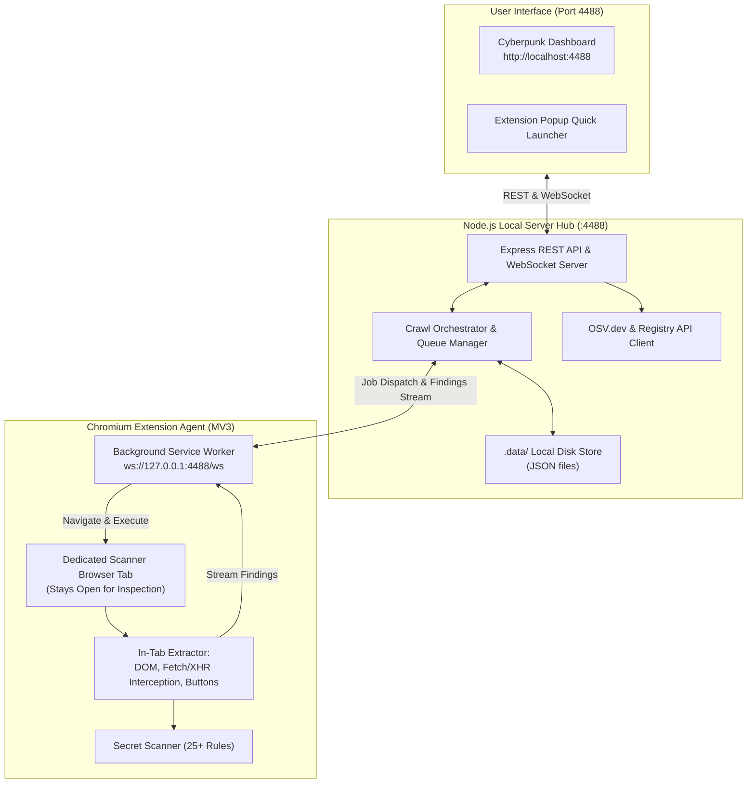

<div align="center">


### ⚡ Cyberpunk Web Recon, Secret Spider & Supply Chain Audit Engine ⚡

*A high-velocity web spider, automated secret detector, and dependency vulnerability scanner featuring a local Node.js backend hub on port 4488 and an interactive Chromium extension agent.*

<br/>

[](package.json)
[](#-quick-start)
[](#-100-local-disk-storage-zero-browser-storage)
[](manifest.json)
[](#-installation)
[](LICENSE)

<br/>

[🚀 Quick Start](#-quick-start) • [✨ Key Features](#-key-features) • [💾 Local Storage Architecture](#-100-local-disk-storage-zero-browser-storage) • [🧠 Architecture](#-architecture--workflow) • [📡 REST API](#-rest-api-reference) • [💻 Usage Guide](#-usage-guide) • [📤 Pipeline Integration](#-exporting--pipeline-integration)

</div>

---

## 🌟 Overview

**Crawlizer** merges the raw reconnaissance power of headless web crawlers with client-side DOM execution, automated secret discovery, and software supply chain auditing. 

Unlike traditional CLI tools that struggle with single-page applications (React, Next.js, Vue, Angular) and get immediately blocked by anti-bot protections, Crawlizer utilizes a **hybrid architecture**:
1. **Local Server Hub (`http://localhost:4488`)**: A lightweight Node.js daemon that manages target queues, deduplication, live WebSocket telemetry, OSV.dev CVE audits, and persistent storage saved **100% locally on disk** in `.data/`.
2. **Chromium Extension Agent**: A Manifest V3 background service worker that navigates targets in a dedicated browser tab using your authenticated browser profile, bypasses CAPTCHAs, executes client-side JavaScript, and streams discovered endpoints, secrets, and dependencies to your local server in real time.

---

## ✨ Key Features

<div align="center">

| Feature | Description |
| :--- | :--- |
| 🖥️ **Local Server Hub (`:4488`)** | Runs on `http://localhost:4488` with `npm run dev`. Provides a standalone dashboard and REST API. |
| 💾 **100% Local Disk Storage** | **Zero data stored in the browser**. All targets, endpoints, secrets, findings, and settings live in `.data/` on disk. |
| 🎯 **Dedicated Tab Navigation** | Navigates queued URLs in a single tab without tab churn. **The scanner tab remains open** for manual inspection. |
| 🔑 **Live Secret Detection** | 420+ curated entropy and regex rules detecting AWS keys, GitHub PATs, JWTs, Stripe keys, Slack webhooks, cloud credentials, and private keys. |
| 📦 **Supply Chain Security Audit** | Identifies frontend dependencies across npm, PyPI, Go, and Maven; queries OSV.dev for CVEs; flags dependency confusion risks. |
| 🛡️ **Zero-Friction CAPTCHA Solving** | Detects Cloudflare Turnstile, reCAPTCHA, and hCaptcha. Pauses scan, alerts you with audio, and resumes after solving. |
| 🖱️ **Interactive DOM Exploration** | Monkey-patches `window.fetch` and `XMLHttpRequest`, auto-clicks interactive `<button>` elements, tabs, and menus. |
| 🌐 **Apex & Subdomain Auto-Scoping** | Smart apex domain scoping (`*.domain.com`) handles redirects (e.g. `tesla.com` → `www.tesla.com`) seamlessly. |
| 🧹 **Strict Canonical Deduplication** | Parameter sorting, port cleansing, and directory traversal normalization to prevent crawling loops. |
| 🔌 **Live Extension Telemetry** | Unmistakable real-time indicator (`EXTENSION: CONNECTED` vs `EXTENSION: DISCONNECTED`) with auto-heartbeat & reconnection diagnostics. |
| 🎨 **Cyberpunk Glassmorphism UI** | Modern dark-mode interface with ambient glows, real-time RPS telemetry, matrix background, and audio feedback. |

</div>

---

## 💾 100% Local Disk Storage (Zero Browser Storage)

Crawlizer strictly isolates data storage to your local disk. **No data is saved in browser IndexedDB, `localStorage`, or `sessionStorage`**:

```
d:\EXT\urls\.data/
├── targets.json        # Enqueued, crawling, and finished seed targets
├── urls.json           # All discovered endpoints, methods, scopes & types
├── secrets.json        # Consolidated sensitive findings with source locations
├── supply_chain.json   # Discovered packages, OSV CVE advisories & risk scores
├── settings.json       # Crawler depth, timeouts, regex & user preferences
└── logs.json           # Real-time event log history (last 500 records)
```

- **Clean Browser Footprint**: Any legacy browser databases are purged automatically on initialization.
- **Persistent Across Restarts**: Stop and restart `npm run dev` at any time without losing target progress or discovered endpoints.
- **Direct CLI Access**: Easily inspect or pipe JSON files into command-line utilities like `jq`, `grep`, or custom scripts.

---

## 🧠 Architecture & Workflow



---

## 🚀 Quick Start

### 1. Start the Local Server
Make sure you have [Node.js](https://nodejs.org/) installed (v18+ recommended):

```bash
# Clone the repository
git clone https://github.com/bountrixorg/Crawlizer.git
cd Crawlizer

# Install dependencies
npm install

# Start the local server on default port 4488
npm run dev
```

The server will initialize on **`http://localhost:4488`** and create the `.data/` directory automatically.

---

### 2. Install the Browser Extension

1. Open your Chromium-based browser (Chrome, Brave, Edge):
   - **Chrome**: Navigate to `chrome://extensions/`
   - **Brave**: Navigate to `brave://extensions/`
   - **Edge**: Navigate to `edge://extensions/`
2. Enable **Developer mode** (toggle in the top-right corner).
3. Click **Load unpacked** (top-left).
4. Select the project directory (`d:\EXT\urls`).
5. The **Crawlizer** extension icon will appear in your toolbar!

---

### 3. Start Crawling

1. Open your browser and go to **`http://localhost:4488`** (or click the extension icon and select **Open Full Dashboard**).
2. Paste target URLs or drag & drop a `.txt` seed file (e.g., `alive.txt` from `httpx` or `subfinder`).
3. Click **⚡ Start Crawl**.
4. The extension will automatically open a dedicated browser tab, visit each URL, extract all endpoints and secrets, and stream findings back to your dashboard!

---

## 📡 REST API Reference

The local server exposes a clean REST API on `http://localhost:4488`:

| Endpoint | Method | Description |
| :--- | :---: | :--- |
| `/api/status` | `GET` | Returns server health, agent connection status, queue count, and metrics. |
| `/api/metrics` | `GET` | Returns aggregated statistics (total targets, endpoints, secrets, packages). |
| `/api/targets` | `GET` | Retrieves all seed targets from `.data/targets.json`. |
| `/api/targets` | `POST` | Enqueues new target URL(s) (`{ url: "..." }` or `{ urls: [...] }`). |
| `/api/targets/:id` | `PATCH` | Updates a target's status or metadata. |
| `/api/targets/reactivate` | `POST` | Resets all targets to `pending` for a fresh crawl run. |
| `/api/targets` | `DELETE` | Clears all seed targets from disk. |
| `/api/urls` | `GET` | Queries discovered URLs with optional `?type=`, `?search=`, and `?limit=`. |
| `/api/urls` | `POST` | Batch-inserts discovered URLs with automatic canonical deduplication. |
| `/api/urls` | `DELETE` | Clears all discovered endpoints. |
| `/api/secrets` | `GET` | Queries discovered secrets with optional `?severity=` and `?search=`. |
| `/api/secrets` | `POST` | Saves discovered secrets with location consolidation. |
| `/api/secrets` | `DELETE` | Clears all discovered secrets. |
| `/api/supply-chain` | `GET` | Retrieves supply chain findings with optional `?ecosystem=` and `?severity=`. |
| `/api/supply-chain/analyze`| `POST` | Performs real-time registry check & OSV.dev CVE scan for a package. |
| `/api/settings` | `GET` | Returns all configuration settings from `.data/settings.json`. |
| `/api/settings/:key` | `GET` | Retrieves a specific setting value. |
| `/api/settings/:key` | `POST` | Saves a specific setting value to disk. |
| `/api/crawl/start` | `POST` | Starts or resumes the crawl orchestrator (`{ targets: [...] }` optional). |
| `/api/crawl/pause` | `POST` | Pauses active crawl dispatching. |
| `/api/crawl/resume` | `POST` | Resumes a paused crawl session. |
| `/api/crawl/stop` | `POST` | Stops crawling and resets active jobs. |
| `/api/crawl/active-tab` | `POST` | Triggers immediate audit of the currently active browser tab. |
| `/api/wipe` | `POST` | Resets all scan data from disk (targets, URLs, secrets, supply chain, logs). |

---

## 💻 Usage Guide

### Target Scope & Configuration

- **Execution Mode**: Choose **Single-Tab Browser** for full client-side JS execution and interactive CAPTCHA bypass, or **Fast Fetch** for background asset spidering.
- **Subdomain Crawling (`*.domain.com`)**: Enable to automatically spider all discovered subdomains under the seed's apex domain.
- **Button Exploration**: Intercepts button clicks, tab switches, and dropdowns to uncover hidden API routes.
- **Asset Guard**: Never renders `.js` or `.css` files directly in browser tabs; extracts their code in background workers for deep regex parsing.

### CAPTCHA & WAF Challenge Handling

When encountering Cloudflare Turnstile, hCaptcha, or Google reCAPTCHA:
1. Crawlizer **pauses crawling immediately** and triggers an audible alert.
2. Click **⚡ Focus Tab** to bring the scanner tab into focus.
3. Solve the challenge manually.
4. Click **I Solved It, Continue** to resume crawling with valid authenticated cookies!

---

## 📤 Exporting & Pipeline Integration

Export your findings directly into your security workflow:

| Format | Description | Command-Line Example |
| :--- | :--- | :--- |
| **TXT** | One URL per line (clean, deduplicated) | `cat urls.txt \| nuclei -t http/cves/` |
| **JSON** | Full metadata array with types and sources | `jq '.[] \| select(.scope=="in-scope") \| .url' urls.json` |
| **CSV** | Spreadsheet-ready with timestamps | Open in Excel, Google Sheets, or LibreOffice Calc |
| **Clipboard** | Instant copy to clipboard | Paste directly into Burp Suite Target Scope |

### Pipeline with Nuclei & HTTPX:
```bash
# 1. Export discovered URLs from Crawlizer (or fetch directly from API)
curl -s http://localhost:4488/api/urls | jq -r '.[].url' > crawlizer_endpoints.txt

# 2. Probe discovered endpoints with httpx
httpx -l crawlizer_endpoints.txt -status-code -title -tech-detect -o alive_endpoints.txt

# 3. Scan for vulnerabilities using Nuclei
nuclei -l alive_endpoints.txt -t cves/ -t exposures/ -t vulnerabilities/
```

---

## 📁 Repository Structure

```
Crawlizer/
├── .data/                # Local persistent data directory (stored 100% on disk)
│   ├── targets.json      # Seed targets
│   ├── urls.json         # Discovered URLs
│   ├── secrets.json      # Sensitive secrets
│   ├── supply_chain.json # Dependency audits
│   ├── settings.json     # User configuration
│   └── logs.json         # System event logs
├── background.js         # Chrome extension background agent & WebSocket client
├── crawler-engine.js     # Single-tab browser manager & link extractor
├── dashboard.html        # Modern Cyberpunk Control Center UI
├── dashboard.css         # Dark cyberpunk glassmorphism stylesheet
├── dashboard.js          # Dashboard controller, charts, filters & exports
├── manifest.json         # Chrome Manifest V3 extension configuration
├── package.json          # Node.js dependencies & npm scripts (default: 4488)
├── popup.html            # Extension popup launcher
├── popup.css             # Extension popup stylesheet
├── popup.js              # Extension popup controller
├── secret-scanner.js     # 420+ secret detection regex rules & entropy checks
├── server.js             # Local Express & WebSocket server hub
├── storage.js            # Server-backed client engine (zero browser storage)
├── supply-chain-scanner.js# Package dependency & CVE auditing engine
├── icons/                # High-resolution extension icon suite
├── alive.txt             # Sample seed targets file
└── README.md             # Project documentation
```

---

## 🛡️ Responsible Use & Disclaimer

> [!WARNING]
> **Crawlizer** is designed for authorized penetration testing, bug bounty hunting, and defensive security auditing. Only test systems you own or have explicit, documented permission to assess. Unsolicited scanning of third-party systems may violate terms of service or applicable computer fraud laws.

---

## 📜 License

Distributed under the **MIT License**. See `LICENSE` for more information.

<div align="center">

Crafted with ⚡ for the cybersecurity & bug bounty community by [bountrixorg](https://github.com/bountrixorg).

</div>

## Contributors & Credits

<table>
  <tr>
    <td align="center">
      <a href="https://github.com/bytes-Knight">
        
        <br />
        <strong>bytes-Knight</strong>
      </a>
    </td>
    <td align="center">
      <a href="https://github.com/bountrixorg">
        
        <br />
        <strong>bountrixorg</strong>
      </a>
    </td>
  </tr>
</table>
